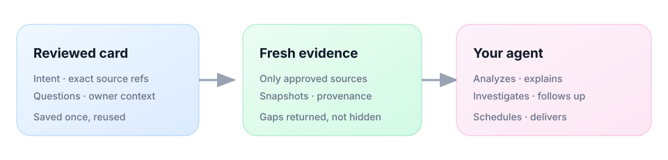

<p align="center">
  
</p>

<p align="center">
  <strong>Describe what matters. Give your agent a repeatable way to watch it.</strong><br>
  Evidence-backed analytics workflows over the BI stack you already use.
</p>

<p align="center">
  <a href="https://github.com/waddle-zoo/signal-weave/actions/workflows/ci.yml"></a>
  <a href="LICENSE"></a>
</p>

SignalWeave is an open-source **MCP service for recurring analytics**. It helps
Codex, Claude, and other agents turn business questions into reusable cards:
what to watch, which sources to read, what deserves attention, and who needs to
know. A successful card evaluation gives your agent source evidence, a
typed policy decision, and an inspectable receipt to investigate and explain.

Run it **on your laptop or on a server**. Keep your dashboards, data tools, and
agent; add a shared, repeatable brief for investigations, alerts, and reports.

<p align="center">
  
</p>

## Get started

On macOS or Linux, install the published native preview and start setup:

```sh
set -o pipefail; curl --fail --silent --show-error --location --proto '=https' --proto-redir '=https' https://github.com/waddle-zoo/signal-weave/releases/download/v0.2.0rc3/install.sh | sh -s -- --version v0.2.0rc3 --setup && export PATH="$HOME/.local/bin:$PATH"
```

Supports macOS 15+ (Apple Silicon/Intel) and Linux x64 with glibc 2.35+.
The macOS preview is not notarized; managed devices may require an approved
install method.

Already installed? Add `--replace` before `--setup` to upgrade while preserving
your local data.

The wizard lets you choose Jev, OpenAI Decisions, or ChatGPT-plan sign-in,
connect your BI sources, and register with Codex or Claude. Credentials stay in
your private `~/.signalweave` directory. Then ask your agent:

> Use SignalWeave to set up a daily online-sales check. Help me choose the
> sources and alert criteria, and ask about missing context. Show me the card
> for review; after I approve it, run one check without sending a message.

[Local setup guide](docs/local-install.md) · [Server deployment](docs/server-deployment.md)

See [release compatibility](docs/local-install-reference.md#release-compatibility)
for available builds and upgrade instructions.

To remove the native executable, run `signalweave uninstall`; local data stays
for a reinstall. See [uninstall instructions](docs/local-install.md#uninstall)
to remove the agent connection or permanently purge local data.

Install the bundled workflow skill in your project:

```sh
signalweave skills install --agent codex   # or: --agent claude
```

Then ask your agent to use `$signalweave`. The skill guides source discovery,
owner clarification, card review, recurring runs, and concise evidence-backed
messages. See the [agent walkthrough](docs/agent-workflows.md).

## What you can build

| Workflow | What the card preserves | What your agent does with the result |
| --- | --- | --- |
| Daily sales check | Comparable periods, planned promotions, significant changes, team destinations | Investigates channel or funnel changes and sends a focused update |
| Customer-health review | Account populations, health definitions, related support signals | Explains which accounts need attention and prepares the team's digest |
| Cross-dashboard investigation | Related charts, business questions, diagnostic sources, escalation criteria | Follows the evidence, checks competing explanations, and briefs the right people |

Use one card per recurring business question. Cards can combine dashboards,
charts, saved queries, and context from multiple connected sources.

## Cards: business context you can reuse

A card is a reusable business brief, not a rigid list of metric thresholds.
For example:

> **Watch:** online sales and their contribution to net sales.
>
> **Why:** catch unexpected revenue losses before the weekly review.
>
> **Look for:** a meaningful drop, excluding planned promotions and reporting gaps.
>
> **Investigate:** which channels, products, or funnel stages explain the change?
>
> **Delivery:** involve Analytics and Data Trust first; send Leadership the
> findings once the investigation supports them.

Your agent helps discover and inspect sources, clarify the business rules, and
save a card for review. Approve it once the source scope and policy match what
you want to repeat. You can revise the card as the business changes.

Under the hood, `what_to_watch` and `why_watch` preserve intent; `watch_for`
and `questions` focus the investigation; `decision_guidance` defines the policy;
and `delivery_methods` names the destinations for each outcome.
See an [example card](examples/insight-card.json) and the
[onboarding walkthrough](docs/local-investigations.md#set-up-a-card).

## Evidence + decisions + your agent

```text
Your brief → reviewed card → source evidence → typed decision → agent investigation/report
```

SignalWeave gives the agent:

- **Evidence bundles:** normalized observations, source links, comparison
  quality, and freshness information; large receipts are available in pages.
- **Typed policy results:** an outcome such as `ignore`, `investigate`, or
  `notify`, with probabilities, watch-item results, and question judgments.
- **Workflow handoffs:** configured destinations and evidence-plan slots for
  follow-up, so an investigation can continue across multiple steps.
- **Saved receipts:** inspect a past run and replay the same evaluation key
  without repeating completed source reads or inference.

If a judgment exceeds its input budget, SignalWeave returns a deferred evidence
handoff for your agent rather than inventing a policy decision.

[TypeSafe Jev](https://docs.typesafe.ai/introduction) applies plain-English
policy through typed judgments and probability distributions. That lets a
workflow branch on a decision without parsing an essay. SignalWeave also
supports [OpenAI Decisions](https://developers.openai.com/api/docs/guides/decisions)
and ChatGPT-plan Responses; Responses probabilities are model estimates rather
than native Decisions distributions.

Your frontier agent handles deeper analysis, causal interpretation, chart
creation, and the concise explanation people read. Your agent or workflow
runner schedules the checks and sends the messages. SignalWeave supplies the
reusable context and evidence-backed decision handoff.

For an extended investigation, see the
[multi-step contract](docs/multi-step-workflows.md) and
[example investigation agent](examples/investigation_agent/README.md).

## Connect your existing stack

**Superset and Preset** provide dashboard and chart evidence. **Trino** provides
catalog-defined metric queries. **Hex and Looker** have hosted read-only adapters.
Company-specific sources can use a reviewed [MCP source bridge](docs/mcp-source-bridge.md)
or the [adapter contract](docs/source-adapters.md).

The local wizard covers Superset, Preset, Trino, and company MCP manifests;
[hosted connector configuration](docs/hosted-connectors.md) covers Hex and Looker.
With the optional `full` MCP profile, [metric query cards](docs/metric-query-cards.md)
select approved definitions and compile bounded SQL for Trino.

## Local or server

- **Local:** the native executable connects to your agent over stdio, with
  private card and receipt storage. The CLI includes connection
  management, credential rotation, live health checks, and an optional local UI.
- **Server:** expose the same card workflow through Streamable HTTP MCP, with
  bearer-token or OIDC authentication, persistent storage, and health endpoints.
  Use the [server guide](docs/server-deployment.md) or the
  [Preset Docker deployment](docs/preset-integration.md#self-hosted-quickstart).

Hosted BI stays where it is; SignalWeave runs beside it. A server deployment can
serve your existing agents and workflow runners without installing a new BI UI.

## Examples and evaluations

Explore the [Northstar sales workflow](docs/northstar-growth-history-trial.md),
[company MCP example](examples/local-investigation/README.md), and
[evaluation index](docs/evaluations.md) for the current results and useful historical trials.
Reports include the setup, measured results, and open issues. They are simulated
evaluations, not customer performance guarantees.

## Develop

```sh
git clone https://github.com/waddle-zoo/signal-weave.git
cd signal-weave
uv sync --extra dev
make verify
```

See [contributing](CONTRIBUTING.md), [agent instructions](AGENTS.md),
[security and operations](docs/security.md), and the [roadmap](ROADMAP.md). Licensed under
[Apache 2.0](LICENSE).
